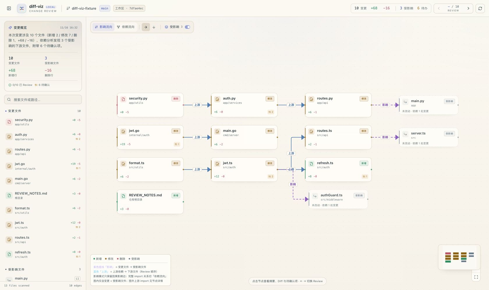
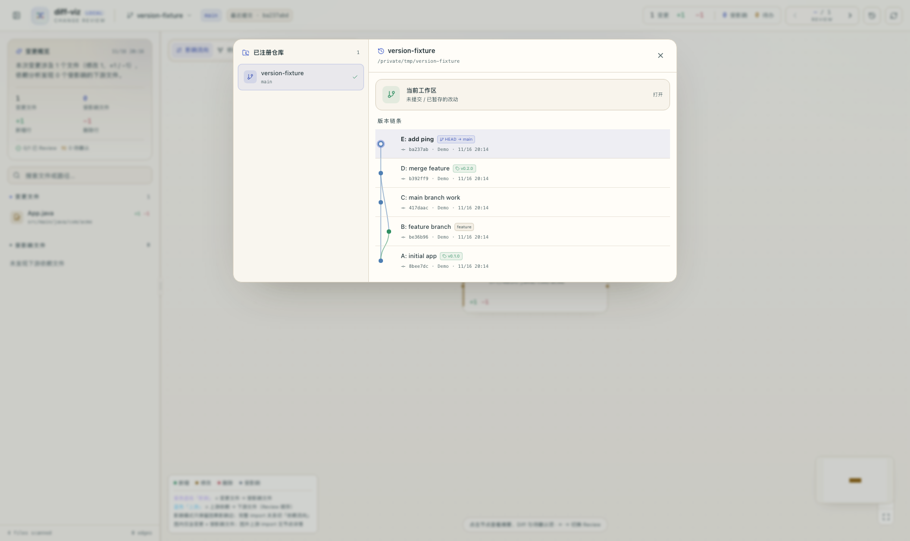
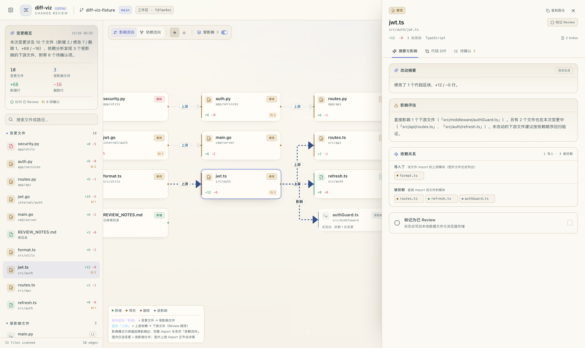
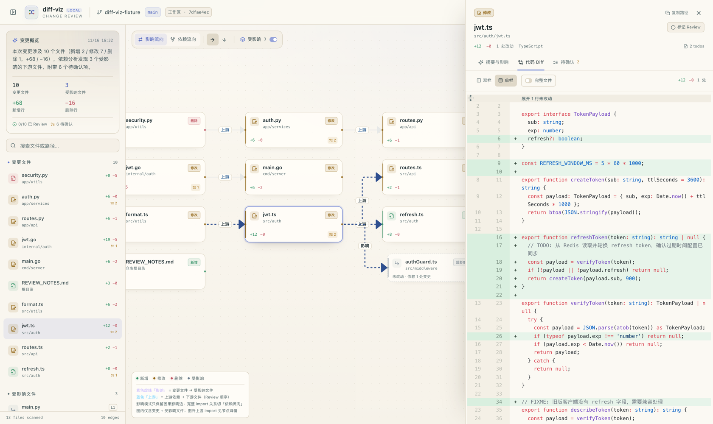
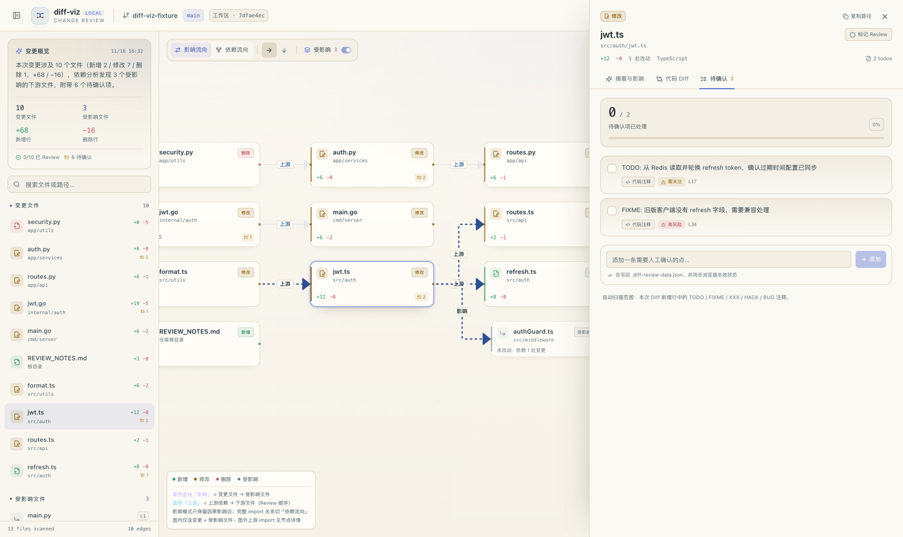

# diff-viz

[](https://github.com/mdhUser/diff-viz/actions/workflows/ci.yml)
[](LICENSE)

本地运行的代码变更可视化 Review 工具：读取 Git diff，静态解析文件依赖，生成可交互的变更拓扑图，并启动一个常驻本地 hub 查看改动摘要、代码 Diff 与待确认事项。hub 可复用、可切换仓库、可浏览历史提交。



## 为什么用它

普通 `git diff` 只能线性地看文件，很难回答这些问题：

- 这次改动会沿 import 链影响哪些**没有改过**的文件？
- 先看哪个文件、后看哪个文件，才是正确的 Review 顺序？
- Agent 改完之后，哪些点必须由人确认？代码里新加的 TODO/FIXME 散落在哪？

`diff-viz` 把这些问题整合成一张「变更 → 影响」的有向图，并提供一个可点击的详情抽屉。

## 功能

- **变更提取**：工作区（暂存 + 未暂存）、暂存区、最近一次提交、commit range、与目标分支对比。
- **依赖拓扑**：静态解析 JS/TS（含 `tsconfig` 的 `baseUrl` / `paths` 别名）、Python、Go、Java 的 import，构建 Nodes / Edges。
- **状态区分**：新增（绿）、修改（黄）、删除（红）、受影响但未改动（灰色虚线）。
- **Review 流程**：按依赖顺序给出 reviewOrder，`←` / `→` 逐个文件切换，标记已 Review。
- **三段式详情**：改动摘要与影响评估、Side-by-Side / Unified 代码 Diff（语法高亮）、待确认 TODO 列表。
- **Agent 注解**：Agent 可把自己的总结、影响分析、风险点写入 JSON；界面直接展示并支持勾选确认。
- **单 hub 复用**：多个仓库、多次分析共用一个常驻进程，不再为每次 Review 启动新端口。
- **仓库与历史**：界面内切换已注册仓库，通过版本链条浏览最多 80 个提交（含分支、tag、merge），查看历史 commit 的 Diff + 依赖拓扑。
- **状态持久化**：勾选状态写回 hub 的 Review 缓存，同时备份到 `localStorage`。
- **零运行时依赖**：CLI 只用 Node.js 内置模块；`dist/` 已包含构建好的前端资源。

## 快速开始

要求：Node.js >= 20，Git 仓库。

```bash
cd diff-viz

# 直接运行（dist 已构建）
node bin/diff-viz.mjs

# 或链接成全局命令
npm link
diff-viz
```

默认行为：

1. 当前工作区有改动 → Review 工作区（包含暂存与未暂存、未跟踪的新文件）。
2. 工作区干净 → Review 最近一次提交。
3. 生成 `.diff-review-data.json`。
4. 确保一个常驻 hub 在 `http://127.0.0.1:5173`（端口被占用会自动递增），把本次结果注册进去并打开浏览器。
5. CLI 随后退出；hub 留在后台，后续分析复用它。

hub 默认把项目列表和 Review 缓存放在 `~/.diff-viz/`；如果该目录不可写（例如 Agent 沙箱），会自动落到系统临时目录。也可以显式指定：

```bash
DIFF_VIZ_HOME=/path/to/state node bin/diff-viz.mjs
```

修改前端源码后需要重新构建：

```bash
npm install
npm run build
```

## 常用命令

```bash
# hub 管理
node bin/diff-viz.mjs hub      # 前台启动/查看 hub
node bin/diff-viz.mjs stop     # 停止后台 hub

# 只看已暂存
node bin/diff-viz.mjs --staged

# 最近一次提交
node bin/diff-viz.mjs --last

# 指定 commit 范围（支持 A..B / A...B）
node bin/diff-viz.mjs --range main..HEAD

# 与目标分支比较（自动取 merge-base）
node bin/diff-viz.mjs --base main

# 只生成 JSON，不开界面
node bin/diff-viz.mjs --json-only --quiet

# 重新打开已有的数据文件（注册到 hub，不新起进程）
node bin/diff-viz.mjs serve --data .diff-review-data.json

# 前台启动/查看 hub，停止 hub
node bin/diff-viz.mjs hub
node bin/diff-viz.mjs stop

# 把 Agent / 人工总结合并进已有数据
node bin/diff-viz.mjs annotate \
  --data .diff-review-data.json \
  --annotations .diff-review-annotations.json
```

完整参数：

| 参数 | 说明 |
| --- | --- |
| `--staged` | 仅查看暂存区 |
| `--last` | 最近一次提交 |
| `--range <A..B\|A...B>` | 提交范围 |
| `--base <ref>` | 与目标分支的 merge-base 比较 |
| `--data <file>` | 数据文件路径，默认 `<repo>/.diff-review-data.json` |
| `--annotations <file>` | 生成时合并注解 JSON |
| `--summary <text>` | 覆盖整体摘要 |
| `--impact-depth <n>` | 下游影响深度，默认 2 |
| `--max-impact <n>` | 最多展示受影响文件数，默认 120 |
| `--no-untracked` | 不纳入未跟踪的新文件 |
| `--json-only` | 只写 JSON，不注册 hub、不启动服务 |
| `--port <n>` | hub 端口，默认 5173（被占用自动递增） |
| `--host <addr>` | 监听地址，默认 127.0.0.1 |
| `--no-open` | 不自动打开浏览器 |
| `--repo <dir>` | 指定仓库目录 |
| `hub` | 前台启动/查看常驻 hub |
| `stop` | 停止后台 hub |
| `--quiet` | 减少日志输出 |

## 界面

### 拓扑视图

- 默认「影响流向」：
  - `影响`（紫色虚线）= 变更文件 → 受它影响的下游文件；
  - `上游`（蓝色实线）= 上游依赖 → 下游文件，用于确定 Review 顺序，不宣称因果关系。
  - 已经改动、但只是「依赖了某个受影响文件」的边不会画成反向影响边；完整 import 关系切到「依赖流向」查看。
- 「依赖流向」：箭头恢复为 `A imports B` 的原始方向，展示当前图内文件的真实 import 关系；图外上游依赖见节点详情。
- 「受影响」开关用于隐藏/显示未改动的下游文件。
- 左右两块面板都可以拖拽边缘调整宽度：拖动分隔条即可，双击或按 `Home` 恢复默认宽度；宽度按浏览器保存在 `localStorage` 中。键盘用户可以先 `Tab` 聚焦分隔条，再用 `←` / `→` 调整。
- 支持横向 / 纵向布局、缩放、拖拽画布、MiniMap。
- 节点颜色与左上角图例一致；虚线边框表示该文件本身没有改动。

### 仓库与提交历史

点击顶部仓库名（或历史图标）打开面板：

- 左侧列出 hub 中注册过的仓库，点击切换；
- 右侧「当前工作区」重新分析未提交改动；
- 「版本链条」按提交父子关系绘制，显示 `HEAD`、分支、tag 和 merge 车道；最多加载 80 个 commit。
- 点击任意提交节点，查看该提交的 Diff 和依赖拓扑。



切换后 URL 会变成 `?review=...`，刷新页面仍停留在同一个 Review。

### 详情抽屉



- **摘要与影响**：展示 `summary` / `impactAnalysis`，以及完整的上游 import、下游依赖（包括未画进图里的文件）、变更来源。
- **代码 Diff**：默认 Unified 单栏（窄抽屉更易读），可切换双栏、完整文件；支持语法高亮、按行号定位、折叠未改动区域。
- **待确认**：自动扫描新增行中的 TODO/FIXME/XXX/HACK/BUG，也展示 Agent 写入的 `todos`；可勾选完成、添加人工备注。





快捷键：`←` / `→` 切换 Review 文件，`Esc` 关闭抽屉。

## Agent 集成

推荐流程（也适用于任意 LLM Agent）：

1. Agent 完成代码修改。
2. Agent 阅读 `git diff`，写出注解文件 `.diff-review-annotations.json`。
3. 运行 `diff-viz --annotations` 生成数据并拉起界面。
4. 把本地 URL 和整体摘要告诉用户。

注解文件格式：

```json
{
  "meta": {
    "overallSummary": "本次改动重构了 refresh token 轮换逻辑，并同步调整了 TS/Python/Go/Java 四端调用。"
  },
  "nodes": {
    "src/auth/jwt.ts": {
      "summary": "新增 refreshToken()，verifyToken() 增加 exp 类型校验。",
      "impactAnalysis": "authGuard 和 /api/routes 依赖 verifyToken；旧客户端没有 refresh 字段，需要兼容。",
      "todos": [
        {
          "text": "确认 Redis 中 refresh token 的 TTL 与 JWT 过期时间一致",
          "severity": "high",
          "category": "config"
        },
        { "text": "补一个过期边界的单测" }
      ]
    }
  }
}
```

- `nodes` 也可以是数组，每项带 `path` 或 `id`。
- `todos` 支持字符串或 `{ text, severity, category }`；`severity` 可选 `high` / `medium`。
- 已存在的 TODO 会按文本去重。
- 不想重启服务时，修改注解文件后执行 `annotate`，浏览器点「刷新」即可。

完整的 Agent 使用说明见 [SKILL.md](SKILL.md)。

在其他 Agent（Claude Code / Cursor / OpenAI Codex 等）中安装和使用，见 [docs/agent-integrations.md](docs/agent-integrations.md)。

## 数据契约

默认写入 `.diff-review-data.json`：

```json
{
  "meta": {
    "timestamp": "2026-11-13T10:00:00Z",
    "branch": "feature/auth-update",
    "overallSummary": "本次改动重构了用户鉴权逻辑。",
    "rangeLabel": "工作区 · 7dfae4ec",
    "stats": { "changedFiles": 10, "impactedFiles": 3, "additions": 68, "deletions": 16, "todos": 6 }
  },
  "nodes": [
    {
      "id": "src/auth/jwt.ts",
      "label": "jwt.ts",
      "path": "src/auth/jwt.ts",
      "status": "modified",
      "stats": { "additions": 12, "deletions": 0 },
      "summary": "新增 refreshToken()。",
      "impactAnalysis": "影响 authGuard 与 routes。",
      "todos": [
        { "id": "c-todo-17", "text": "TODO: ...", "source": "code_comment", "completed": false, "line": 17 }
      ],
      "diff": "@@ -1,27 +1,39 @@ ...",
      "oldContent": "...",
      "newContent": "...",
      "language": "typescript",
      "imports": ["src/utils/format.ts"],
      "importedBy": ["src/api/routes.ts", "src/auth/refresh.ts"]

    }
  ],
  "edges": [
    { "id": "e-...", "source": "src/api/routes.ts", "target": "src/auth/jwt.ts", "relation": "imports" }
  ]
}
```

约定：

- `status`: `added` | `modified` | `deleted` | `impacted_only`。
- `edges.source` **import 了** `edges.target`（依赖边）。UI 的「影响流向」会在渲染时反向画箭头。
- `impacted_only` 表示该文件没有改动，但（间接）依赖了变更文件。
- `oldContent` / `newContent` 是完整文件内容，仅用于浏览器内 Diff；超过 400,000 字符会截断。
- `imports` / `importedBy` 是该文件**完整**的直接依赖列表，包含没有画进图里的上游文件；详情抽屉会把这些文件标成「图外」。
- `meta.reviewOrder` 是依赖优先的 Review 顺序；`meta.warnings` 记录扫描上限等提示。
- 额外字段（`summarySource`、`reviewed`、`impactOrigins`、`depth`、`binary` 等）用于界面增强，不属于必需字段。

## 依赖解析与影响模型

| 语言 | 解析内容 | 解析范围 |
| --- | --- | --- |
| JS / TS / JSX / TSX / Vue / Svelte | `import`、`export ... from`、`require()`、动态 `import()` | 相对路径、`tsconfig.json` / `jsconfig.json` 的 `baseUrl`、`paths`、`index.*`、`.js` → `.ts` |
| Python | `import a.b`、`from a.b import x`、相对 import | 仓库根目录与 `src/`，`module.py` / `module/__init__.py` |
| Go | `import "..."`、import block | `go.mod` 的 module 前缀 → 目录下的 `.go` 文件 |
| Java | `import com.foo.Bar;`、`import static ...`、`import com.foo.*`、同包类引用 | 按 `package` + 文件名建立 FQCN 索引，支持 Maven/Gradle 的 `src/main/java`、多模块目录 |

影响分析从每个变更文件出发，沿 `被 import` 的反向关系寻找下游文件，最多 `--impact-depth` 层、`--max-impact` 个节点。只展示仓库内文件；`node_modules`、`vendor`、`dist` 等目录会被跳过。

## 状态持久化

- 勾选 TODO / 标记 Review → `POST /api/state` → 写回 hub 中对应的 Review 缓存。
- 同时写入 `localStorage`，hub 不可用时仍可勾选。
- 重新生成同一 Review 时，会按 todo id / 文本保留完成状态和已 Review 标记，并保留手工添加的备注。
- hub 只监听 `127.0.0.1`，不对局域网开放。

## 目录结构

```
diff-viz/
├── bin/diff-viz.mjs        # CLI 入口
├── src/
│   ├── cli.mjs             # 参数解析与命令
│   ├── collect.mjs         # diff → 依赖图 → 数据文件
│   ├── diff-parse.mjs      # unified diff 解析 / TODO 扫描
│   ├── deps.mjs            # JS/TS、Python、Go、Java import 解析
│   ├── git.mjs             # Git 命令封装
│   ├── hub.mjs             # 常驻 hub：仓库注册、历史 Review、状态 API
│   ├── server.mjs          # 单 Review HTTP 服务（兼容/测试）
│   └── util.mjs
├── web/                    # React + Vite + Tailwind 前端源码
├── dist/                   # 已构建前端资源
├── test/                   # node:test 测试
├── scripts/demo.mjs        # 生成演示仓库并启动
├── SKILL.md                # Agent Skill 说明
└── README.md
```

## 开发与测试

```bash
npm install
npm run build
npm test
npm run typecheck
npm run demo        # 创建 .demo 演示仓库并启动界面
```

前端技术栈：React 18、Vite、Tailwind CSS v4、`@xyflow/react`、`dagre`、`react-diff-viewer-continued`、`lucide-react`。

## 限制

- 依赖解析是**静态正则/AST 近似**，不执行代码，也不解析运行时动态路径；别名只读取仓库根目录的 tsconfig/jsconfig。Java 同包引用通过标识符近似匹配，注释/字符串中的同名类名可能产生少量误报。
- 大型 monorepo 超过 15,000 个代码文件时只扫描前 15,000 个，并在 `meta.warnings` 中提示。
- 二进制文件只标记状态，不渲染文本 Diff。
- 不监听文件变化；代码变更后需要重新运行（或点界面刷新读取新 JSON）。
- 数据文件包含完整源码内容，**不要提交到 Git 或分享**。

## 打赏作者

如果这个工具帮你节省了时间，欢迎微信扫码打赏，感谢支持。


## License

MIT
